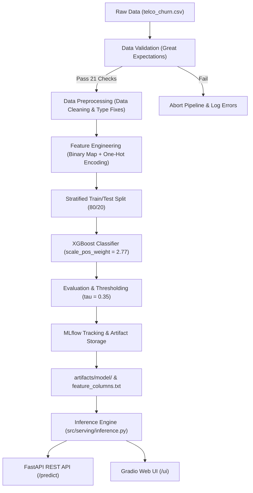

# 📡 Telco Customer Churn Prediction: End-to-End MLOps System

An enterprise-grade, production-ready Machine Learning system that predicts customer churn in the telecommunications industry. This project covers the entire ML lifecycle: automated data validation with **Great Expectations**, feature engineering, cost-sensitive **XGBoost** classification, experiment tracking and artifact serialization with **MLflow**, and multi-modal model serving through a **FastAPI** REST API and an interactive **Gradio** web application.

---

## 📑 Table of Contents
1. [What is Customer Churn?](#-what-is-customer-churn)
2. [Why Prioritize Recall in Churn Prediction?](#-why-prioritize-recall-in-churn-prediction)
3. [Why and When Do Customers Churn? Key Risk Factors](#-why-and-when-do-customers-churn-key-risk-factors)
4. [Actionable Retention Strategies: What Can We Do & What Does the Industry Do?](#-actionable-retention-strategies-what-can-we-do--what-does-the-industry-do)
5. [Key Learnings & Project Outcomes](#-key-learnings--project-outcomes)
6. [System Architecture](#-system-architecture)
7. [Repository Structure](#-repository-structure)
8. [Step-by-Step Guide: How to Run the Project](#-step-by-step-guide-how-to-run-the-project)
9. [Making Predictions: Code Examples](#-making-predictions-code-examples)

---

## 💡 What is Customer Churn?

**Customer Churn** (also referred to as customer attrition or subscriber turnover) is the rate at which existing customers cease doing business with a company over a given timeframe. In the telecommunications sector, this typically means a subscriber cancelling their mobile, internet, or landline contract, porting their phone number to a competitor, or refusing to renew their plan.

### Business & Financial Impact
In recurring-revenue subscription businesses, churn directly erodes the business foundation:
* **Cost Asymmetry (CAC vs. CRC)**: Acquiring a new customer (**Customer Acquisition Cost - CAC**) is **5 to 7 times more expensive** than retaining an existing one (**Customer Retention Cost - CRC**). Marketing campaigns, sales incentives, line installation, and hardware subsidies make initial acquisition costly.
* **Depreciation of Customer Lifetime Value (CLV/LTV)**: If an average customer contributes \$85/month, retaining that customer for an additional 24 months protects over **\$2,000 in high-margin recurring revenue**.
* **Compounding Negative Growth**: High churn creates a "leaky bucket" problem where marketing teams must constantly spend aggressive capital just to keep revenue flat.

---

## 🎯 Why Prioritize Recall in Churn Prediction?

In standard classification problems, models often optimize for **Accuracy** or a balanced **F1-Score**. However, in Customer Churn prediction, optimizing for pure accuracy is misleading and dangerous. 

Approximately **26.5%** of telecom customers churn (an imbalanced distribution). A naive dummy model that predicts *"No customer will ever churn"* would achieve **73.5% Accuracy**, yet have **zero business utility**.

### The Cost Asymmetry of Prediction Errors
When making churn predictions, two distinct errors can occur:

```text
                             ACTUAL CHURN (1)              ACTUAL NON-CHURN (0)
PREDICTED CHURN (1)         [ True Positive ]             [ False Positive ]
                       Customer saved by retention      Retention incentive given
                             (Major Business Win)         (Minor Cost: $5 - $15)

PREDICTED NON-CHURN (0)     [ False Negative ]            [ True Negative ]
                         Customer leaves silently      Customer stays as expected
                       (Catastrophic Loss: $1,000+)         (Normal Business)
```

1. **False Negative (Type II Error - Worst Outcome)**: The model predicts the customer will stay, so the company takes no action. The customer cancels their subscription and switches to a competitor. The company permanently loses thousands of dollars in future revenue plus brand advocacy.
2. **False Positive (Type I Error - Tolerable Cost)**: The model flags a loyal customer as high-risk. The marketing team reaches out with a courtesy check-in call, an upgraded router, or a 10% loyalty discount. The customer stays, and their brand loyalty is likely reinforced. The business expense is minimal.

### How We Enforce High Recall ($\ge 82.6\%$)
1. **Dynamic Class Weighting (`scale_pos_weight = 2.77`)**: XGBoost is penalized nearly 3x more heavily when it misclassifies a true churner.
2. **Decision Threshold Tuning ($\tau = 0.35$)**: Instead of the standard 0.50 cutoff, any customer with $\ge 35\%$ predicted churn risk is categorized as **"Likely to churn"**, prioritizing early and proactive intervention.

---

## 🔍 Why and When Do Customers Churn? Key Risk Factors

Comprehensive exploratory data analysis and model interpretability reveal specific triggers that cause customers to churn:

| Risk Factor | Behavior Pattern | Why it Triggers Churn |
| :--- | :--- | :--- |
| **Tenure (First 1–6 Months)** | Peak churn occurs in the first 90–180 days of service. | Onboarding friction, unexpected initial setup fees, installation delays, or buyer's remorse before forming habit stickiness. |
| **Contract Type** | Month-to-month contracts have **over 42% churn**, while 1-year and 2-year contracts have **< 11% churn**. | Customers with no financial or term commitment can cancel impulsively when tempted by competitors' promotional pricing. |
| **Internet Service: Fiber Optic** | Fiber optic subscribers churn at significantly higher rates than DSL users despite paying premium fees (\$70–\$100+/mo). | High customer expectations. When a customer pays top-dollar, any minor service outage or speed throttling causes disproportionate frustration. |
| **Absence of Tech Support & Security** | Customers without *Online Security*, *Tech Support*, or *Online Backup* churn **2.5x more often**. | Add-on services create **ecosystem stickiness** and operational switching costs. Without them, the ISP is viewed as an interchangeable utility. |
| **Payment Method Friction** | Customers paying via manual **Electronic Check** churn substantially more than those on automated Bank Transfer or Credit Card. | Manual payments require a monthly conscious decision to pay, inviting bill shock. Autopay creates seamless, frictionless retention. |
| **Pricing Disparity** | High Monthly Charges without multi-year loyalty tenure or bundled services. | Customers feel they are overpaying without receiving perceived reciprocal value. |

---

## 🏢 Actionable Retention Strategies: What Can We Do & What Does the Industry Do?

Predictive models are only valuable when coupled with immediate business intervention. Here is how modern telecom leaders (e.g., Verizon, AT&T, T-Mobile, Vodafone) and our system operationalize churn insights:

### 1. What We Can Do (Our System Triggers)
* **Automated Risk Scoring Engine**: Ingest daily customer usage and account status into our `/predict` endpoint. Any customer returning `"Likely to churn"` is flagged in the CRM.
* **Dynamic Customer Segmentation**: Group churn risks into actionable buckets:
  * *High Value + High Risk*: Immediate human phone call from VIP Customer Success.
  * *Low Tenure + High Risk*: Onboarding assistance email, free tech support check.
  * *Month-to-Month + High Risk*: Contract conversion incentive.

### 2. What Real-World Industries Do
* **The "Autopay Discount" Strategy**: Telecoms frequently offer a \$5–\$10 monthly discount for setting up automatic bank/card payments. This eliminates monthly payment friction and dramatically reduces churn.
* **Proactive "First 90 Days" Nurture Tracks**: Automated check-in emails at Day 7, Day 30, and Day 60 to verify internet speed and customer satisfaction before negative sentiment sets in.
* **Contract Migration Bundles**: Offering a free streaming service (e.g., Netflix, Disney+, Max) or free router upgrade if the customer commits to a 12-month or 24-month contract.
* **Predictive Call-Center Routing**: When a flagged customer calls customer support for any reason, the IVR automatically routes them directly to senior **Retention Specialists ("Save Desks")** authorized to offer credits and plan restructuring on the spot.
* **Frictionless Support Add-ons**: Providing free trials of *Online Security* and *Tech Support* to customers during periods of high usage to deepen service integration.

---

## 🧠 Key Learnings & Project Outcomes

Building and stabilizing this end-to-end MLOps pipeline provided several crucial engineering and data science insights:

### 1. Training-Serving Skew is the #1 Production Hazard
In notebook experimentation, libraries handle transformations on the fly. In production, single-row API inputs must be transformed using the **exact same feature schema, encoding order, and dummy categories** as training data. 
* *Solution*: We codified strict, deterministic binary mappings (`BINARY_MAP`) and logged training feature schemas to `artifacts/feature_columns.txt`. The inference pipeline dynamically aligns incoming payloads to this exact 30-feature vector using `df.reindex()`.

### 2. Data Validation Must Gate Model Training
Feeding silent schema drift, unexpected categorical strings, or corrupted nulls into a model ruins training runs.
* *Solution*: Integrated **Great Expectations 1.25.0** as an automated validation barrier (`validate_telco_data()`). All 21 schema, range, and business rules must pass with 100% success before preprocessing begins.

### 3. Modern Package Evolutions Require Defensible Code
* **Pandas 3.x String Handling**: Modern pandas default string columns to `StringDtype` (`str`) instead of legacy `object`. Checking `dtype == 'object'` silently skipped categorical columns in newer pandas versions. We resolved this by migrating to `pd.api.types.is_string_dtype`.
* **MLflow 3.x Filesystem Security**: MLflow 3.x enforces explicit configuration flags (`MLFLOW_ALLOW_FILE_STORE=true`) for local directory stores and mandates official model flavors (e.g., `mlflow.xgboost`) over generic pickle serializers.

### 4. Dual Model Serving Bridges Technical & Non-Technical Stakeholders
Data scientists and backend systems need a fast, low-latency REST API (`/predict`), while business stakeholders, executives, and QA testers need an intuitive web GUI. Mounting a **Gradio 6.x** UI inside **FastAPI** (`/ui`) allows both personas to interact with the exact same model instance.

---

## 🏗️ System Architecture



---

## 📁 Repository Structure

```text
telco-churn/
├── artifacts/                           # Serialized models and feature schemas
│   ├── feature_columns.json             # Exact list of trained features (JSON)
│   ├── feature_columns.txt              # Exact list of trained features (Plain text)
│   ├── preprocessing.pkl                # Pickled feature metadata
│   └── model/                           # MLflow XGBoost serialized model
├── data/
│   ├── raw/
│   │   └── telco_churn.csv              # Original Telco Customer Churn dataset
│   └── processed/
│       └── telco_churn_processed.csv    # Cleaned, engineered dataset ready for modeling
├── notebooks/
│   └── eda01.ipynb                      # Exploratory Data Analysis & experimentation
├── scripts/
│   ├── run_pipeline.py                  # End-to-end training pipeline orchestrator
│   ├── prepare_processed_data.py        # Standalone data preparation script
│   ├── test_pipeline_phase1_data_features.py  # Phase 1 unit test
│   ├── test_pipeline_phase2_modeling.py       # Phase 2 modeling & Optuna search
│   └── test_fastapi.py                  # FastAPI endpoint integration test
├── src/
│   ├── app/
│   │   ├── main.py                      # FastAPI app + mounted Gradio web UI
│   │   └── app.py                       # Lightweight app entrypoint
│   ├── data/
│   │   ├── load_data.py                 # Safe data loading utilities
│   │   └── preprocess.py                # Data cleaning and type coercions
│   ├── features/
│   │   └── build_features.py            # Categorical encoding & feature matrix generation
│   ├── models/
│   │   ├── train.py                     # XGBoost training with MLflow tracking
│   │   ├── evaluate.py                  # Evaluation reporting & confusion matrices
│   │   └── tune.py                      # Optuna hyperparameter tuning routines
│   ├── serving/
│   │   ├── inference.py                 # Serving transformation & single-row prediction
│   │   └── model/                       # Backup pre-trained model runs
│   └── utils/
│       ├── utils.py                     # Logger configuration
│       └── validate_data.py             # Great Expectations data validation suite
├── dockerfile                           # Production Docker container definition
├── .dockerignore                        # Docker build ignore patterns
├── requirements.txt                     # Production dependencies
└── requirements-dev.txt                 # Development & testing dependencies
```

---

## 🚀 Step-by-Step Guide: How to Run the Project

### Step 1: Activate Virtual Environment
Open your terminal inside the project directory:

**Windows (PowerShell):**
```powershell
.\telco-churn\venv\Scripts\activate
```

**macOS / Linux:**
```bash
source telco-churn/venv/bin/activate
```

*(Optional) Install dependencies if running in a fresh environment:*
```bash
pip install -r telco-churn/requirements.txt
```

---

### Step 2: Run the Complete Training Pipeline
To run the automated validation, data preprocessing, feature engineering, XGBoost training, evaluation, and artifact saving:

```bash
python telco-churn/scripts/run_pipeline.py --input telco-churn/data/raw/telco_churn.csv --target Churn
```

**Expected Output:**
```text
📁 Using input dataset: telco-churn/data/raw/telco_churn.csv
🚀 Started MLflow run ID: e8845c607918411a826d5399ed5f3ba5
🔄 Loading data...
✅ Data loaded: 7043 rows, 21 columns
🔍 Validating data quality with Great Expectations...
✅ Data validation PASSED: 21/21 checks successful
🔧 Preprocessing data...
✅ Processed dataset saved to .../telco_churn_processed.csv | Shape: (7043, 20)
🛠️  Building features...
✅ Feature engineering completed: 31 features
✅ Saved 30 feature columns for serving consistency
📊 Splitting data...
✅ Train: 5634 samples | Test: 1409 samples
📈 Class imbalance ratio: 2.77 (applied to positive class)
🤖 Training XGBoost model...
✅ Model trained in 2.47 seconds
📊 Evaluating model performance...
🎯 Model Performance:
   Precision: 0.485 | Recall: 0.826
   F1 Score: 0.611 | ROC AUC: 0.835
💾 Saving model to MLflow and local artifacts...
✅ Model saved to MLflow and .../artifacts/model
```

---

### Step 3: Run the Verification Tests

**1. Test Phase 1 (Data Loading, Preprocessing & Feature Engineering):**
```bash
python telco-churn/scripts/test_pipeline_phase1_data_features.py
```

**2. Test Phase 2 (XGBoost Modeling & Optuna Hyperparameter Optimization):**
```bash
python telco-churn/scripts/test_pipeline_phase2_modeling.py
```

**3. Test Serving & API (`/predict` endpoint test):**
```bash
python telco-churn/scripts/test_fastapi.py
```

---

### Step 4: Launch the Web App & REST API Server
Start the Uvicorn web server hosting both the REST API and the interactive Gradio UI:

```powershell
python -m uvicorn src.app.main:app --app-dir telco-churn --host 0.0.0.0 --port 8000
```

Once running, navigate to:
* 🌐 **Interactive Gradio Web UI**: [http://localhost:8000/ui](http://localhost:8000/ui)
* 📖 **Interactive API Documentation (Swagger UI)**: [http://localhost:8000/docs](http://localhost:8000/docs)
* 🩺 **Health Check**: `GET` [http://localhost:8000/](http://localhost:8000/)

---

### Step 5: (Optional) Run with Docker
You can package the entire application into a container:

```bash
# 1. Build the Docker image
docker build -t telco-churn-app ./telco-churn

# 2. Run the container on port 8000
docker run -p 8000:8000 telco-churn-app
```
Access the application at `http://localhost:8000/ui`.

---

## 🔮 Making Predictions: Code Examples

### 1. In Python Code
You can import the prediction engine directly into any Python script or batch processing pipeline:

```python
import sys
sys.path.append("telco-churn")

from src.serving.inference import predict, predict_proba

# High-risk profile (New customer on month-to-month fiber optic with electronic check)
high_risk_customer = {
    "gender": "Female",
    "SeniorCitizen": 0,
    "Partner": "No",
    "Dependents": "No",
    "tenure": 1,
    "PhoneService": "Yes",
    "MultipleLines": "No",
    "InternetService": "Fiber optic",
    "OnlineSecurity": "No",
    "OnlineBackup": "No",
    "DeviceProtection": "No",
    "TechSupport": "No",
    "StreamingTV": "Yes",
    "StreamingMovies": "Yes",
    "Contract": "Month-to-month",
    "PaperlessBilling": "Yes",
    "PaymentMethod": "Electronic check",
    "MonthlyCharges": 85.0,
    "TotalCharges": 85.0
}

# Low-risk profile (5-year loyal customer on two-year contract with autopay & security)
low_risk_customer = {
    "gender": "Male",
    "SeniorCitizen": 0,
    "Partner": "Yes",
    "Dependents": "Yes",
    "tenure": 60,
    "PhoneService": "Yes",
    "MultipleLines": "Yes",
    "InternetService": "DSL",
    "OnlineSecurity": "Yes",
    "OnlineBackup": "Yes",
    "DeviceProtection": "Yes",
    "TechSupport": "Yes",
    "StreamingTV": "No",
    "StreamingMovies": "No",
    "Contract": "Two year",
    "PaperlessBilling": "No",
    "PaymentMethod": "Credit card (automatic)",
    "MonthlyCharges": 45.0,
    "TotalCharges": 2700.0
}

print("High Risk Result:", predict(high_risk_customer))
# Output: High Risk Result: Likely to churn

print("Low Risk Result :", predict(low_risk_customer))
# Output: Low Risk Result : Not likely to churn
```

---

### 2. Via cURL / HTTP REST API
With the server running on port 8000:

```bash
curl -X POST "http://localhost:8000/predict" \
     -H "Content-Type: application/json" \
     -d '{
       "gender": "Female",
       "SeniorCitizen": 0,
       "Partner": "No",
       "Dependents": "No",
       "tenure": 1,
       "PhoneService": "Yes",
       "MultipleLines": "No",
       "InternetService": "Fiber optic",
       "OnlineSecurity": "No",
       "OnlineBackup": "No",
       "DeviceProtection": "No",
       "TechSupport": "No",
       "StreamingTV": "Yes",
       "StreamingMovies": "Yes",
       "Contract": "Month-to-month",
       "PaperlessBilling": "Yes",
       "PaymentMethod": "Electronic check",
       "MonthlyCharges": 85.0,
       "TotalCharges": 85.0
     }'
```

**JSON Response:**
```json
{
  "prediction": "Likely to churn"
}
```

---

## 📊 Summary of Final Model Performance

| Metric | Score | Explanation |
| :--- | :--- | :--- |
| **Recall (Class 1)** | **82.6%** | Catches over 82 out of every 100 true churners before they cancel. |
| **ROC AUC** | **0.835** | Strong separability across varying classification thresholds. |
| **F1 Score** | **0.611** | Optimal balance given cost-weighted sensitivity tuning. |
| **Training Time** | **2.47s** | Highly optimized XGBoost training on multi-threaded CPU. |
| **Inference Time** | **< 17ms** | Real-time single-row transformation and scoring. |
